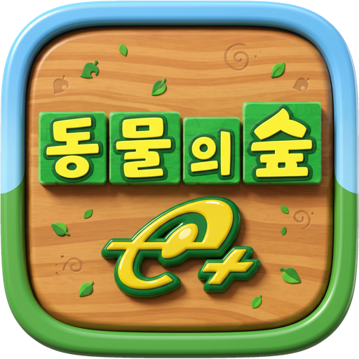

<p align="center"><a href="README.md">English</a> · <b>한국어</b></p>

<p align="center"></p>

<h1 align="center">afe-port</h1>

<p align="center">
  게임큐브 「동물의 숲 e+」(どうぶつの森e+)를 Windows·Linux·Android에서 직접 실행하는 포트입니다.<br>
  <a href="https://github.com/cailet0422/afe-decomp">afe-decomp</a> 디컴파일을 바탕으로 하며, 한글패치를 지원합니다.
</p>

<p align="center">
  <a href="https://github.com/cailet0422/afe-port/releases"></a>
  <a href="https://github.com/cailet0422/afe-port/actions/workflows/tests.yml"></a>
</p>

## 다운로드

<!-- 새 릴리즈를 내면 아래 링크의 버전을 바꾼다(README.md도 함께). -->
최신 릴리즈: **[v1.0.1](https://github.com/cailet0422/afe-port/releases/tag/v1.0.1)**

| 플랫폼 | 다운로드 | 필요 사항 |
|---|---|---|
| Windows 64비트 | [DobutsuNoMoriEPlus-v1.0.1-Windows-x64.zip](https://github.com/cailet0422/afe-port/releases/download/v1.0.1/DobutsuNoMoriEPlus-v1.0.1-Windows-x64.zip) | OpenGL 3.3 (`SDL2.dll` 포함) |
| Windows 32비트 | [DobutsuNoMoriEPlus-v1.0.1-Windows-x86.zip](https://github.com/cailet0422/afe-port/releases/download/v1.0.1/DobutsuNoMoriEPlus-v1.0.1-Windows-x86.zip) | OpenGL 3.3 (`SDL2.dll` 포함), 64비트 Windows에서도 실행 |
| Linux x86_64 | [DobutsuNoMoriEPlus-v1.0.1-Linux-x86_64.zip](https://github.com/cailet0422/afe-port/releases/download/v1.0.1/DobutsuNoMoriEPlus-v1.0.1-Linux-x86_64.zip) | SDL2(`libsdl2-2.0-0`), OpenGL 3.3 |
| Android | [DobutsuNoMoriEPlus-v1.0.1-Android.apk](https://github.com/cailet0422/afe-port/releases/download/v1.0.1/DobutsuNoMoriEPlus-v1.0.1-Android.apk) | Android 5.0 이상, ARM 32·64비트 |

체크섬: [SHA256SUMS.txt](https://github.com/cailet0422/afe-port/releases/download/v1.0.1/SHA256SUMS.txt) ·
이전 버전과 릴리즈 노트: [전체 릴리즈](https://github.com/cailet0422/afe-port/releases)

> [!IMPORTANT]
> **게임 데이터는 들어 있지 않습니다.** 본인이 가진 「どうぶつの森e+」 일본판 **Rev 1 (GAEJ01)**
> 디스크 이미지(`.iso` / `.ciso` / `.gcm`)가 있어야 합니다. 디스크 이미지는 배포하지 않습니다. 릴리즈
> 빌드에는 디스크에서 꺼낸 에셋이 없고, 실행할 때 본인의 디스크 이미지에서 모두 읽어 옵니다.

> [!NOTE]
> 릴리즈는 리눅스에서 자동 입력 스크립트로 폭넓게 확인했고 Windows판은 Wine, Android판은
> 에뮬레이터에서 확인했지만, 실제 Windows PC와 Android 기기에서는 아직 충분히 확인하지 못했습니다. 문제가 있으면 [이슈](https://github.com/cailet0422/afe-port/issues)로 알려 주세요.

## 특징

- SDL2와 OpenGL 3.3 / OpenGL ES 3.0으로 Windows(32·64비트), Linux, Android(ARM 32·64비트)에서
  에뮬레이터 없이 직접 실행됩니다.
- 디스크 이미지에서 바로 읽으며, 원래 이미지는 바꾸지 않습니다.
- 게임 안 설정·일시정지 메뉴: 화면 설정, 키보드·게임패드 키 바꾸기, 디스크 폴더 선택.
- 한글패치 지원: 게임 안에서 패치 zip을 골라 바로 적용하고, 한국어와 일본어를 언제든 오갈 수 있습니다.
  실제 키보드(두벌식)나 화면 키보드로 한글을 입력합니다.
- Android: 화면 터치 게임패드, 실제 게임패드, 비정상 종료 시 다음 실행 때 크래시 리포트 표시.
- 미니맵: 마을 야외에서는 왼쪽 아래에 마을 지도가 작게 나옵니다(내 위치와 보는 방향, 주민 집).
  **M** 키로 언제든 게임의 전체 지도를 열고 닫을 수 있고(파출소에서 지도를 받기 전에도), Android에서는
  미니맵을 터치하면 열립니다. **Settings** → **Gameplay** → **Minimap**에서 끌 수 있습니다.
- 자동 업데이트: v1.0.0부터 게임을 켤 때 새 릴리즈가 있는지 확인하고 설치를 제안합니다(세이브, 설정,
  디스크, 한글패치는 그대로). **Settings** → **Gameplay** → **Updates**에서 끌 수 있습니다.
- 패미컴 가구 게임(최고 점수 저장 포함)과 부팅 징글도 동작합니다.
- 게임큐브 메모리 카드 세이브(GCI)를 `afe_gci` 도구로 가져오고 내보낼 수 있습니다(소스에서 빌드).

## 시작하기

### Windows / Linux

1. 받은 zip을 풀고, 풀린 `DobutsuNoMoriEPlus` 폴더 안에 `rom` 폴더를 만들어 디스크 이미지를 넣습니다.
   Windows에서는 이 단계를 건너뛰어도 됩니다. 이미지를 찾지 못하면 이미지가 있는 폴더를 고르는
   안내(**폴더 선택**)가 뜹니다.
2. `DobutsuNoMoriEPlus.exe`(Linux는 `./DobutsuNoMoriEPlus`)를 실행합니다. 세이브는 같은 폴더의 `save/`에
   생깁니다.

### Android

1. 디스크 이미지를 폰의 폴더에 둡니다(예: `Download/동물의숲`. `Download` 바로 아래는 고를 수 없으니
   그 안에 폴더를 만듭니다).
2. APK를 설치하고(출처를 알 수 없는 앱 허용) 실행한 뒤, **폴더 선택**으로 그 폴더를 고릅니다.
3. 화면 터치 게임패드나 실제 게임패드로 플레이합니다.

APK는 정식 키로 서명되어 있어(인증서 SHA-256
`db6fc1ad60b6b6d980bee0990f120ef481f195f117729fa194b124d14752e8b7`) 새 버전을 덮어서 설치해도 세이브가
유지됩니다. 세이브는 `Android/data/org.afedecomp.dobutsunomori/files/save/`에 있습니다.
앱이 비정상으로 끝나면 다음 실행 때 게임을 띄우기 전에 원인을 보여 주는 창이 뜹니다. **복사**를 눌러
이슈에 붙여 주세요.

### 업데이트

v1.0.0부터는 위의 다운로드가 스스로 업데이트됩니다. 게임을 켤 때
[릴리즈](https://github.com/cailet0422/afe-port/releases)를 확인해서 새 버전이 있으면 일시정지 메뉴가 열리고
**Update now**(지금 업데이트), **Later**(나중에), **Skip this version**(이 버전 건너뛰기) 중에서 고릅니다.

- Windows / Linux: 새 zip을 받아 릴리즈의 `SHA256SUMS.txt`와 맞춰 본 뒤 게임 폴더의 파일을 바꾸고,
  **Restart now**를 고르면 새 버전으로 다시 시작합니다. `rom/`, `save/`, `korean/`과 설정은 건드리지
  않습니다. 게임 폴더에 쓸 수 있어야 합니다(`Program Files` 안은 안 됨). Linux에서는 `curl`이나 `wget`이
  필요합니다.
- Android: 새 APK를 받아 확인한 뒤 시스템 설치 화면을 엽니다(Android가 물으면 이 앱의 설치를 허용하세요).
  기존 버전 위에 설치되어 세이브와 한글패치가 그대로 남습니다.

업데이트는 이 저장소의 릴리즈에서만 받고, 소스에서 빌드한 게임은 스스로 업데이트하지 않습니다.
**Settings** → **Gameplay** → **Updates**에서 확인을 끌 수 있습니다(`settings.ini`의 `auto_update = 0`).
v0.1.6 이하는 스스로 업데이트하지 못하니 v1.0.0은 한 번 직접 받아 주세요.

### 한국어로 플레이하기

한글패치는 이 프로젝트와 별개인 팬 패치입니다.

1. [retrodb 한글패치 — 동물의 숲 e+](https://retrodb.info/krpatch/7428/%EB%8F%99%EB%AC%BC%EC%9D%98-%EC%88%B2-e)에서
   패치 zip을 받습니다(패치 v0.9.2·v0.9.3 확인).
2. 원래 디스크로 게임을 실행하고 일시정지 메뉴(PC는 **Esc**, Android는 **뒤로** 버튼) → **Settings** →
   **Disc** → **Korean patch: Install**을 엽니다.
3. 받은 zip을 그대로 고릅니다(Windows·Android는 파일 선택 창, Linux는 먼저 게임 폴더의 `patch/`에 zip을
   넣어 둡니다).
4. 1초 안팎으로 끝나면 **Restart now**를 고릅니다.

한글판 이미지는 `korean/`에 따로 만들어지고 원래 이미지는 그대로 남습니다. 같은 탭의
**Korean: On / Off**로 한국어판과 원래 디스크를 오갈 수 있습니다.

### 기본 조작 (PC)

| 게임큐브 | 키보드 |
|---|---|
| 컨트롤 스틱 | W / A / S / D |
| C스틱 | 방향키 |
| 십자키 | I / J / K / L |
| A / B | Space / 왼쪽 Shift |
| X / Y / Z | X / Y / Z |
| L / R | Q / E |
| Start | Enter |
| 마을 지도 (열기 / 닫기) | M |
| 일시정지 메뉴 | Esc |

일시정지 메뉴 → **Settings** → **Controls** → **Buttons**에서 바꿀 수 있고, 게임패드 버튼도 여기서
정합니다. 한글 입력 화면에서는 실제 키보드로 두벌식 입력을 할 수 있습니다(한/영 키, 오른쪽 Alt 또는
Shift+Space로 전환).

## 알려진 제한

- SD 카드, GBA 연동, 카드e리더는 "장치 없음"으로 처리됩니다(게임이 각자의 안내 문구를 보여 줍니다).
- 한글로 길게 쓴 편지에는 주민이 답장하지 않습니다. 한글패치가 답장 여부를 일본어 낱말 표로 정하는
  코드를 그대로 두었기 때문이며, 게임큐브에서도 같습니다.
- 일본어판에서 만든 세이브를 한글패치 디스크로 불러오면 세이브에 저장된 이름이 한글 글자와 섞여
  보입니다(게임큐브에서도 같습니다).

## 소스에서 빌드하기

빌드에도 본인 디스크가 필요합니다. 디컴프의 매칭 빌드와 일부 생성 소스를 디스크에서 만들기 때문입니다.
Linux(데스크톱 기본값인 32비트)에서 빠르게 시작하려면:

```sh
sudo apt install gcc-multilib g++-multilib cmake ninja-build python3 libsdl2-dev:i386 libgl-dev:i386
git clone --recursive https://github.com/cailet0422/afe-port.git
cd afe-port
python3 pc/tools/gcdisc.py extract-orig <디스크.ciso> decomp/orig/GAEJ01_01
(cd decomp && python3 configure.py --version GAEJ01_01 && ninja)
cmake -S pc -B pc/build32 -G Ninja -DCMAKE_TOOLCHAIN_FILE=$PWD/pc/cmake/Toolchain-multilib32.cmake
ninja -C pc/build32
```

디스크 이미지를 `pc/build32/bin/rom/`에 넣고 `pc/build32/bin/DobutsuNoMoriEPlus`를 실행합니다. 디컴프를
다른 곳에 두었다면 cmake에 `-DDECOMP_ROOT=<afe-decomp 경로>`를 줍니다.

그 밖의 빌드 — MinGW 교차 빌드로 Windows, 64비트(`-DPC_ALLOW_64BIT=ON`), Android(Gradle), 배포용 에셋
없는 빌드(`-DPC_STRIP_ASSETS=ON`과 `dist` 타깃) — 는 아래 개발 문서에 있습니다.

### 문서

모든 문서는 영어판(`*.md`)도 있습니다.

| 문서 | 내용 |
|---|---|
| [docs/README.ko.md](docs/README.ko.md) | 구조, 플랫폼별 빌드·실행 방법, 마일스톤, 알려진 문제 |
| [docs/android.ko.md](docs/android.ko.md) | Android 빌드, 서명, 터치 조작 |
| [docs/64bit.ko.md](docs/64bit.ko.md) | 디컴프의 64비트 포팅 |
| [docs/korean_patch.ko.md](docs/korean_patch.ko.md) | 한글패치 형식과 포트의 지원 방식 |
| [docs/dev_setup.ko.md](docs/dev_setup.ko.md) | 개발 환경, 테스트 스크립트, 세이브 도구 |

## 저장소 구성

| 경로 | 내용 |
|---|---|
| `pc/` | 플랫폼 계층: SDL2, OpenGL/GLES 렌더러, 오디오, 디스크 읽기, 설정·일시정지 메뉴, 한글패치 설치기, 한글 입력기. Android 프로젝트(`pc/android`), 생성·시험 도구(`pc/tools`), 단위 테스트(`pc/tests`)도 여기 있습니다 |
| `decomp/` | [afe-decomp](https://github.com/cailet0422/afe-decomp) 서브모듈. 게임 코드와 그 안의 `#ifdef TARGET_PC` 훅 |
| `docs/` | 개발 문서(영어판 `*.md`, 한국어판 `*.ko.md`) |

## 기여하기

게임 코드의 PC용 수정은 afe-decomp에 `#ifdef TARGET_PC` 안으로만 커밋합니다. 그래야 매칭 빌드가 원래
바이너리를 그대로 만듭니다(해시는 [docs/README.ko.md](docs/README.ko.md)에 있습니다). 그 커밋이 들어가면 이
저장소에서 `decomp` 서브모듈을 올립니다.

게임 데이터(디스크 이미지, 디스크에서 추출한 에셋, 그것이 들어간 빌드 결과물 — 에셋을 넣어 빌드한 실행
파일·APK)는 절대 커밋하지 않습니다.

## 크레딧과 라이선스

- `pc/`의 플랫폼 계층은 [ACGC-PC-Port](https://github.com/flyngmt/ACGC-PC-Port)(MIT)를 바탕으로
  했습니다([pc/LICENSE](pc/LICENSE)). 패미컴 게임에는 [FixNES](https://github.com/FIX94/fixNES)(MIT)를
  씁니다.
- 디컴프(`decomp/`)는 afe-decomp의 라이선스(CC0 1.0)를 따릅니다.
- 한글패치는 이 저장소와 관계없는 별도 제작자(역전맞고)의 작업입니다. 이 저장소와 그 관리자는 패치 제작에
  참여하지 않았고, 패치 파일·번역문·글꼴은 저장소에 넣지 않습니다. 패치 자체에 관한 문의는 패치 배포처로
  해 주세요.
- 「동물의 숲」(Animal Crossing, どうぶつの森)은 Nintendo의 상표입니다. 이 프로젝트는 비공식 팬 프로젝트이며
  Nintendo와 관계가 없고 Nintendo의 승인을 받지 않았습니다.
